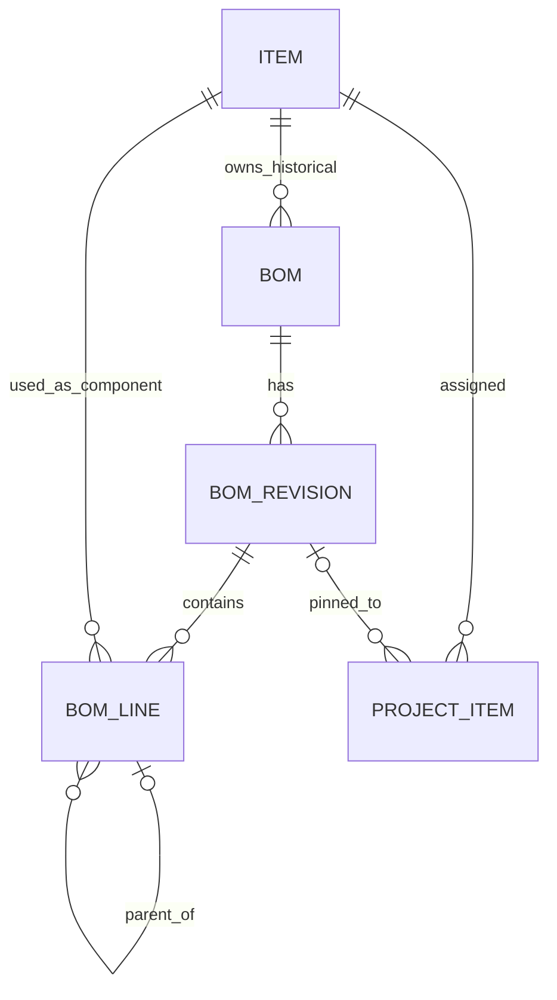
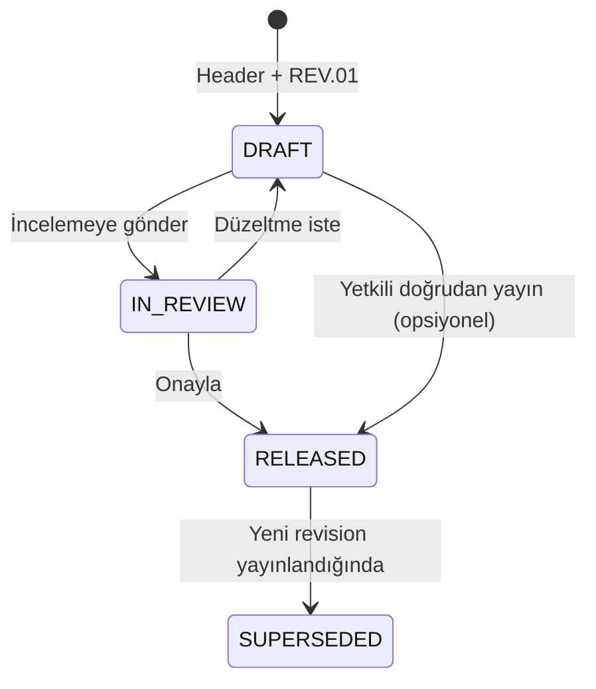

# mQDMS — Item & BOM Refactor Plan

**Kapsam:** Faz 2 refactor (Item, BOM, BOM Revision, BOM Line, TreeGrid, ERP import ve Project Product Structure)  
**Durum:** R1–R3 uygulandı (şema, Item sınıflandırma, BOM domain, TreeGrid + editör). R4–R5 bekliyor.  
**Tarih:** 15 Kasım 2026  
**Repository:** `uzansadik/mqdms`  
**Hedef:** Faz 3 Process Flow geliştirmesinden önce ürün ağacını sadeleştirmek ve güvenilir hale getirmek.

---

## 0. Uygulama durumu (15 Kasım 2026)

### Tamamlanan iş paketleri

| Paket | Durum | Nerede |
|---|---|---|
| **R1** Item sınıflandırma ve şema | ✅ | `item.isSellable`, `item.structureType` (`item_structure_type` enum), Item formu/listesi/detayı, stok kodu ile birebir çözümleme (`resolveItemByStockCodeAction`) |
| **R1** Şema geçişleri (expand) | ✅ | `packages/db/drizzle/0007_foamy_wolfsbane.sql`, `0008_slimy_lethal_legion.sql`, `0009_noisy_la_nuit.sql` |
| **R2** BOM domain ve revision | ✅ | Tek aktif BOM (partial unique), `revisionNumber` + otomatik `REV.xx`, `lockVersion`, `parentLineId` + composite FK, `lineageId`, snapshot'lar, yaşam döngüsü (DRAFT → IN_REVIEW → RELEASED → SUPERSEDED), batch taslak kaydetme, lineage tabanlı diff |
| **R3** Ortak TreeGrid | ✅ | `packages/ui/src/components/tree-grid/` (TanStack Table v8 + React Virtual, `role="treegrid"`, klavye/ARIA), BOM grid adaptörü (`bom-tree-grid.tsx`), stok kodu + Enter akışı, taslak tamponu, çakışma yönetimi |
| **R3** Eski kod yollarının kaldırılması | ✅ | `bom-line-form.tsx`, `bom-tree.tsx`, `bom-explosion.tsx`, `bom-revision-form.tsx`, `bom-line-actions.tsx` silindi; `child_bom_revision_id` kolonu kaldırıldı |

### Bekleyen iş paketleri

| Paket | Kapsam | Not |
|---|---|---|
| **R4** Import | §8 normalize şema, ağaç önizlemesi, idempotency | Mevcut `packages/imports` BOM akışı yeni modele uyarlandı (yazılabilir revision çözümü, `sortOrder` ataması); ağaç importu henüz yazılmadı |
| **R4** Legacy veri dönüşümü | `childBomRevisionId` → kopya ağaç | Üretimde legacy BOM verisi yok; backfill script'i yazılmadı |
| **R4** Project Product Structure | Ortak TreeGrid read-only | Şimdilik `bom-tree-view.tsx` ile salt okunur ağaç gösteriliyor |
| **R5** Kabul testleri | 5.000 satırlık fixture, performans/klavye testleri, production migration planı | E2E senaryoları yazılmadı |

### Migration uygulama notu

`0007` → `0008` → `0009` sırayla uygulanmalıdır. `0008` hedef UNIQUE constraint'i (FK hedefi) ekler, `0009` ise
parent FK'sini ekler — **FK, hedef constraint'ten sonra** gelmelidir. Migration'lar `pnpm db:generate` ile
üretilmiştir; hazır SQL'e dokunulmamıştır.

### Bilinen sapmalar

- `bom_line.line_number` NOT NULL kaldı: revision içinde global sıra olarak kullanılır, veritabanı kısıtı
  korunur. Plan §4.4'teki "global pozisyon gerekmiyorsa kaldır" seçeneği kullanıldı.
- Item formunda `isSellable` ve `structureType` zorunlu alanlardır; veritabanı varsayılanları
  (`false` / `PART`) yalnızca form dışı yazmalarda güvenli değer sağlar.

---

## 1. Amaç ve bağlayıcı kararlar

mQDMS bir ERP/MRP uygulaması değil, ürün yapısına bağlı kalite yönetim platformudur. Dinamo ERP'deki ürün kartları ve çok seviyeli ürün ağacı yeniden kullanılmalı; kullanıcı her alt montaj için ayrı BOM oluşturmak veya BOM revision seçmek zorunda kalmamalıdır.

1. Bir organizasyondaki bir Item için **en fazla bir aktif BOM** bulunabilir.
2. BOM header yalnızca aktif, satılabilir bir mamul (`FINISHED_GOOD`) Item'a bağlanır. Ürün üretilen (`MANUFACTURED`) veya satın alınan (`PURCHASED`) olabilir.
3. BOM header bir kez oluşturulur; ürün yapısı değişiklikleri yeni BOM ile değil, revision ile yönetilir.
4. Her BOM revision bütün ürün ağacını içerir. Alt montajlar ve ara gruplar aynı revision altında `parentLineId` ile bağlanır.
5. BOM header altında başka bir BOM header oluşturulmaz. `childBomRevisionId` yeni modelden kaldırılır; başka Item'ın BOM'u otomatik olarak açılmaz veya bağlanmaz.
6. Çok seviyeli yapı sabit bir iş kuralı derinliğiyle kısıtlanmaz. Sistem döngüleri önler ve büyük ağaçları verimli gösterir.
7. Hammadde ve sarf malzeme kök seviyesinde (ana grup seviyesinde) veya alt satır sahibi olarak kullanılamaz; geçerli grupların altında yaprak olarak kullanılabilir.
8. Revision numarası sistem tarafından atanır: `REV.01`, `REV.02`, `REV.03` … `REV.99`, `REV.100`.
9. BOM satırları ayrı ürün seçme formuyla değil, TreeGrid içinde eklenir. Stok kodu yazılıp Enter tuşuna basıldığında Item kartındaki bilgiler getirilir.
10. TreeGrid, `packages/ui` altında genel amaçlı bir bileşen olur; TanStack Table, TanStack Virtual ve mevcut shadcn/ui altyapısı kullanılır.
11. Project Item, belirli bir BOM revision'a bağlı kalabilir. Yeni revision yayınlandığında onaylı proje/kalite kayıtları kendiliğinden değişmez.

**Yorum/varsayım:** Kullanıcının “ana grup” kuralı hem BOM'un doğrudan çocuklarını hem de herhangi bir seviyede alt satır taşıyan düğümü kapsayacak şekilde yorumlandı. Hammadde/sarf malzeme sadece daha derindeki yaprak olabilir. Mamulün doğrudan altında hammadde bulunan Dinamo ağaçları varsa import önizlemesinde iş kuralı hatası verilir; sistem kendiliğinden sanal grup üretmez. Montaj/grup niteliğinin mevcut Item sınıflandırmasında nasıl temsil edileceği §3'te tanımlanmıştır.

## 2. Hedef ürün ağacı — kabul örneği

Tek BOM: `BOM-1` · Kök Item: `001` · Revision: `REV.01`

```text
001 Elektrikli Bisiklet — 1 Adet [BOM sahibi; header, satır değil]
├─ 100 Gövde Grubu — 1 Adet
│  ├─ 101 Alüminyum Kadro — 1 Adet
│  ├─ 102 Ön Maşa — 1 Adet
│  └─ 103 Bağlantı Civatası M8x20 — 4 Adet
└─ 200 Tahrik ve Güç Grubu — 1 Adet
   ├─ 201 Elektrik Motoru 250W — 1 Adet
   ├─ 202 Batarya Paketi 36V — 1 Adet
   │  ├─ 202-A Lityum İyon Hücre 18650 — 40 Adet
   │  └─ 202-B BMS Devre Kartı — 1 Adet
   └─ 203 Koltuk Ana Grubu — 1 Adet
      └─ 203-A Koltuk Süngeri Grubu — 1 Adet*
         ├─ 203-A-1 Koltuk Süngeri — 1 Adet*
         └─ 203-A-2 Koltuk Süngeri Tutucu Braket Grubu — 2 Adet
            ├─ 203-A-2-1 ST37-Braket — 1 Adet
            └─ 203-A-2-2 M10 Civata — 4 Adet
```

\* Örnekte belirtilmeyen iki miktar yalnızca örnek/test için 1 kabul edilmiştir; gerçek importta miktar zorunludur, tahmin edilmez.

- 1 BOM header, 1 revision, 15 BOM line; kök dahil 16 ürün ağacı düğümü.
- `100`, `200`, `202`, `203`, `203-A`, `203-A-2` ayrı BOM header değildir.
- Kök seviye 0; `203-A-2-1` ve `203-A-2-2` seviye 5'tedir.
- Satır miktarı bir üst gruptan **bir adet** için gereken miktardır. Kök üretim miktarı 1 olduğunda 2 ST37-Braket ve 8 M10 civata gerekir. 10 bisiklet için 20 braket, 80 civata.
- Stok kodları metindir; `001`, `202-A`, `203-A-2-1` birebir korunur. Kodun karakter dizisinden seviye veya ebeveyn türetilmez.

## 3. Item Master refactor

### 3.1 Mevcut ve hedef sınıflandırma

Mevcut `packages/db/src/schema/inventory/item.ts` içinde `itemType`, `supplyType`, `itemGroupId`, `unitOfMeasureId`, `status` alanları bulunuyor. Satılabilirlik ve montaj/grup niteliği ayrı alanlar olarak mevcut şemada bulunmuyor.

Önerilen hedef:

| Alan | Tip / değer | Anlamı |
|---|---|---|
| `code` | text | ERP stok kodu, organizasyon içinde case-insensitive unique |
| `name` | text | Ürün adı |
| `itemType` | mevcut enum | FINISHED_GOOD, SEMI_FINISHED, RAW_MATERIAL, COMPONENT, CONSUMABLE, OTHER |
| `supplyType` | mevcut enum | MANUFACTURED, PURCHASED, OUTSOURCED, MIXED, UNKNOWN |
| `isSellable` | boolean | Satılabilirlik; müşteri numarası bulunmasından bağımsız |
| `structureType` | yeni enum (öneri) | ASSEMBLY, GROUP, PART |
| `itemGroupId` | mevcut FK | Ürün ailesi/sınıflandırma (BISIKLET, FRP, METAL vb.) |
| `unitOfMeasureId` | mevcut FK | Varsayılan birim |
| `status`, `archivedAt` | mevcut | Kullanılabilirlik |

`structureType` ürünün yapısal niteliğini ifade eder. `itemGroupId` ürün ailesidir; ağaçtaki parent rolü ile karıştırılmaz. Item Type, Supply Type ve Sellable üç ayrı eksendir. Örn. `COMPONENT + GROUP + MANUFACTURED + false` geçerli bir ara gruptur.

| Örnek | Item Type | Structure | Supply | Sellable | Item Group |
|---|---|---|---|---|---|
| 001 Elektrikli Bisiklet | FINISHED_GOOD | ASSEMBLY | MANUFACTURED | Evet | BISIKLET |
| 100 Gövde Grubu | COMPONENT | GROUP | MANUFACTURED | Hayır | BISIKLET (örnek) |
| 202 Batarya Paketi | COMPONENT | ASSEMBLY | MANUFACTURED | Hayır | ELEKTRIK (örnek) |
| 103 M8x20 Civata | COMPONENT | PART | PURCHASED | Hayır | METAL (örnek) |
| Reçine | RAW_MATERIAL | PART | PURCHASED | Hayır | KIMYA (örnek) |

### 3.2 Item kuralları

- Kök Item: `FINISHED_GOOD`, `isSellable=true`, `MANUFACTURED` veya `PURCHASED`, `ACTIVE`, arşivlenmemiş. ASSEMBLY veya PART olabilir; satın alınan satılabilir mamule de BOM açılabilir.
- Alt satır sahibi: ASSEMBLY veya GROUP ve itemType `FINISHED_GOOD`, `SEMI_FINISHED` veya `COMPONENT`. RAW_MATERIAL, CONSUMABLE ve PART alt satır taşıyamaz. OTHER varsayılan olarak parent olamaz; gerekirse sınıflandırma düzeltilir.
- Doğrudan kök altındaki satırlar RAW_MATERIAL veya CONSUMABLE olamaz. Diğer uygun parçalar (ör. motor, satın alınan bileşen) yaprak olarak kök altında yer alabilir.
- Hammadde/sarf: yalnızca daha derindeki yaprak satırlar. Üretilen/satın alınan olma durumu tek başına parent olma kriteri değildir.
- Kök Item'ın kendisi hiçbir alt satırda bulunamaz. Aynı Item farklı dallarda tekrarlanabilir; aynı ata zincirinde kendisini içeremez.
- Mevcut kartlar için `isSellable`/`structureType` değerlerini ERP mapping veya kullanıcı doğrulaması ile doldur. Migration sırasında geçici nullable alanlar kullanılabilir; bilinmeyen değerleri otomatik `true`/ASSEMBLY yapma. Backfill tamamlanana kadar yeni BOM açma/yayınlama ilgili doğrulamadan geçmelidir. Veri temizlendikten sonra gerekli alanları NOT NULL yap.
- Bir Item'ın sınıfı sonradan değiştirilirse yayınlanmış BOM snapshot'ı değişmez; yeni taslak/release güncel kurallarla doğrulanır. Aktif BOM kökünü geçersiz kılacak Item değişiklikleri açık hata veya kontrollü arşivleme akışı gerektirir.
- Item listesi ve Item formu yeni alanları gösterir; müşteri kodu, ERP referansı, Item Revision ve Item Unit mevcut ilişkileri korunur.

## 4. Veri modeli

### 4.1 İlişki modeli



ITEM → BOM ilişkisi geçmiş/arşiv kayıtları nedeniyle 1:N olabilir, ancak aynı anda en fazla bir ACTIVE ve arşivlenmemiş header bulunur.

### 4.2 `bom` — header

Mevcut `id`, `organizationId`, `itemId`, `code`, `name`, `description`, `status`, `archivedAt`, audit alanları korunur. `bomType` için yeni ayrı Engineering/Manufacturing BOM yaratma akışı kaldırılır; mevcut alan gerekiyorsa geçmiş için korunur, yeni header varsayılan `MANUFACTURING` olur. Farklı BOM tipleri tek aktif BOM kuralını aşamaz.

- Partial unique index: `(organization_id, item_id) WHERE status = 'ACTIVE' AND archived_at IS NULL`.
- Header oluşturma + ilk revision aynı transaction içinde.
- Aktif header varsa “Yeni BOM” yerine mevcut BOM'a yönlendir; yeniden aktifleştirme aynı unique kurala tabi.
- Header sahibi Item değiştirilemez. Kök miktarı 1, birim Item'dan; UI'da header satır olarak gösterilir ama `bom_line` kaydı değildir.
- `code` organizasyon içinde unique kalır. BOM kodunun otomatik üretilmesi bu talebin zorunlu parçası değildir; mevcut kod formatını koru. `BOM-1` örnek koddur.
- Normal değişikliklerde header arşivlenip yeniden oluşturulmaz. Arşiv, geçmiş ve proje referanslarını korur.

### 4.3 `bom_revision`

| Alan | Karar |
|---|---|
| `id`, `organizationId`, `bomId` | Mevcut ilişkiler |
| `revisionNumber` | integer, pozitif, otomatik, BOM içinde unique |
| `revision` | Ekranda `REV.${number.padStart(2,'0')}`; mevcut string alan tutulursa server tarafından türetilir, manuel düzenlenmez |
| `status` | DRAFT, IN_REVIEW, RELEASED, SUPERSEDED |
| `supersedesRevisionId` | Kopyalanan önceki revision referansı |
| `sourceSystem`, `sourceRevision` | ERP provenance, yerel revision numarasından bağımsız |
| `parentItemRevisionId` | Opsiyonel teknik Item Revision; BOM revision ile aynı şey değildir |
| `changeReason`, `description`, `effectiveFrom`, release/audit alanları | Korunur |
| `lockVersion` | integer; optimistic concurrency için öneri |
| `rootItemSnapshot` | Yayınlanan kök ürünün kod/ad/tip/tedarik/birim gibi tarihsel görünümü (öneri) |

Kısıtlar: unique `(bom_id, revision_number)`; partial unique bir BOM başına en fazla bir RELEASED ve önerilen en fazla bir açık DRAFT/IN_REVIEW. Eski revision'lar SUPERSEDED olarak saklanır. En son oluşturulan taslak, geçerli yayınlanmış revision yerine kullanılmaz.

### 4.4 `bom_line` — adjacency list

| Alan | Karar |
|---|---|
| `id` | UUID, satır occurrence kimliği |
| `organizationId`, `bomRevisionId` | Aynı tenant ve revision |
| `parentLineId` | nullable UUID, aynı revision'daki bir üst satır; null = header altı |
| `childItemId` | Mevcut Item FK; kod kopyalayarak yeni Item üretme |
| `childItemRevisionId` | Opsiyonel teknik parça revision FK |
| `quantity` | Mevcut numeric(18,6), >0; üst grubun bir birimi başına |
| `unitOfMeasureId` | Item varsayılanı otomatik doldurulur; geçerli override doğrulanır |
| `sortOrder` | Ebeveyn içindeki stabil sıralama |
| `lineNumber` | Opsiyonel ERP pozisyonu / mevcut alanın uyarlanması; ağaç kimliği değildir |
| `referenceDesignation`, `joiningMethod`, `positionReference`, `description`, `notes` | Mevcut alanlar, detay panelinde düzenlenebilir |
| `lineageId` | Revision kopyalamalarında aynı occurrence'ı izlemek için UUID (öneri) |
| `itemSnapshot` | Release anındaki kod, ad, tip, yapı türü, supply, satılabilirlik ve birim bilgileri (öneri) |
| `childBomRevisionId` | Kaldırılacak (önce veri dönüşümü) |

- Parent FK: `(organizationId, bomRevisionId, parentLineId)` → `bom_line(organizationId, bomRevisionId, id)`; hedefte composite unique. Parent başka revision veya organizasyonda olamaz.
- `CHECK (parent_line_id IS NULL OR parent_line_id <> id)` ve quantity > 0. Uygulama servisinde uzun döngü kontrolü; yapısal mutasyonlar transaction altında serileştirilir.
- Aynı `childItemId` farklı pozisyonlarda/sibling satırlarda tekrarlanabilir. Unique child item kuralı yok.
- Sibling sıralama için `(organization_id, bom_revision_id, parent_line_id, sort_order)` unique; root null semantiği için PostgreSQL 15+ `NULLS NOT DISTINCT` veya iki partial unique index. Reorder sırasında geçici pozisyon/deferrable constraint stratejisi belirle.
- Mevcut global `(bom_revision_id, line_number)` unique kısıtını kaldır veya yalnızca gerçekten global pozisyon ihtiyacı varsa koru; ERP pozisyonlarını hiyerarşiye göre doğrula. UI sıra numarası path'ten hesaplanabilir (`1.2.3`), stok kodundan veya satır UUID'sinden bağımsızdır.
- Parent ilişkisi için index, revision index ve childItem index ekle. Ağaç tek revision sorgusundan oluşturulur; recursive N+1 alt BOM sorgusu kullanılmaz.
- Parent silme doğrudan cascade ile sessizce yapılmaz. Kullanıcı alt dalı silmeyi açıkça onaylar, servis child-first transaction ile siler (FK NO ACTION tercih edilir). Yayınlanmış veri üzerinde silme yoktur.
- Her satırda `depth` saklamak zorunlu değil; okuma sırasında parent zincirinden hesaplanır. Gerçek iş kuralı maksimum seviyesi yok; import/batch istekleri için kaynak tüketimi limitleri ve anlaşılır hata mesajları uygulanır.

## 5. Revision yaşam döngüsü



1. İlk header oluşturulunca `REV.01 / DRAFT` otomatik oluşur. Revision numarası formdan alınmaz.
2. Kullanıcı yayımlanmış REV.01 üzerinde “Yeni Revizyon” dediğinde REV.02 taslağı oluşturulur. Bütün satırlar aynı transaction'da kopyalanır; eski satır ID → yeni satır ID map'i ile parent bağlantıları yeniden kurulur, `lineageId` korunur. Kaynak revision değiştirilmez.
3. Taslak varken REV.01 RELEASED ve proje kullanımı geçerli kalır. Yeni taslak mevcutsa kullanıcı ona yönlendirilir. Birden fazla açık taslak yaratılmaz.
4. Yayınlama işlemi tüm ağaç, Item sınıfı, miktar/birim, permission ve concurrency kontrollerinden sonra transaction içinde eski RELEASED revision'ı SUPERSEDED, yeni revision'ı RELEASED yapar. Audit log ve snapshot yazılır.
5. DRAFT düzenlenebilir; IN_REVIEW, RELEASED, SUPERSEDED read-only. İnceleme geri dönüşü açık aksiyonla DRAFT'a yapılır. Kullanıcının doğrudan status dropdown ile lifecycle atlaması engellenir.
6. Revision numarası için BOM header row lock (`SELECT ... FOR UPDATE`) ve transaction içinde monoton sayaç/`MAX(revisionNumber)+1`; unique index ile race condition önlenir. Taslak iptali varsa numara tekrar kullanılmaz (header high-water counter önerilir). `REV.100` desteklenir.
7. Revizyon karşılaştırması satır sıra numarasına değil lineage + parent lineage + Item, miktar, birim, sıra, teknik revizyon ve metadata'ya dayanır. Eklenen, silinen, taşınan, değiştirilen ve reorder edilen satırlar gösterilir.
8. Proje daha önce REV.01'e bağlanmışsa REV.02 yayınlandığında otomatik değişmez. Yetkili kullanıcı diff'i inceleyip bilinçli olarak yeni revision'a geçer.

## 6. TreeGrid — `packages/ui`

### 6.1 Mimari ve sorumluluk

Önerilen dizin (`packages/ui` içindeki mevcut export ve component convention'ına uyarlanacak):

```text
packages/ui/src/components/tree-grid/
  tree-grid.tsx
  tree-grid-types.ts
  tree-grid-row.tsx
  tree-grid-cell.tsx
  tree-grid-toolbar.tsx
  use-tree-grid.ts
  use-tree-grid-keyboard.ts
  tree-grid.utils.ts
  index.ts
```

- `@tanstack/react-table`: `getCoreRowModel`, `getExpandedRowModel`, `getSubRows`, stabil `getRowId`, controlled expansion, selection.
- `@tanstack/react-virtual`: görünür/expand edilmiş satırların windowing'i; tüm ağaç DOM'a basılmaz. Scroll container, sticky header, overscan, dinamik satır yüksekliği gerekiyorsa `measureElement`.
- shadcn/ui: Button, Input, DropdownMenu, Tooltip, Badge, Dialog/AlertDialog, ScrollArea ve mevcut design token'ları.
- Genel bileşen generic `TData` ve column definitions alır; BOM/Item/DB/permission iş kuralları içermez. `packages/ui` doğrudan `@mqdms/db` veya app feature'larına bağımlı olmaz.
- `apps/app/features/boms/components/bom-tree-grid.tsx`: alan modeli, stok kodu çözümleme, draft mutation, BOM kolonları, izinler ve hata metinleri burada.
- `project Product Structure` aynı grid'in read-only modunu kullanır.
- Keyboard/focus/ARIA desteği: `role=treegrid`, row/gridcell, `aria-level`, `aria-expanded`, focus yönetimi; virtual scroll sırasında aktif hücre korunur, görünür olmayan hedefe gerektiğinde scroll edilir. Expand/collapse için klavye desteği; input edit modunda tuşlar yanlışlıkla ağaç komutuna dönüşmez.

### 6.2 Kullanıcı ekranı

```text
BOM-1 | 001 Elektrikli Bisiklet | REV.01 [DRAFT]
[+ Satır] [ + Alt Satır ] [Tümünü Aç] [Tümünü Kapat] [Kaydet] [Yayınla]
[Revizyon Geçmişi] [Karşılaştır] [Import]

Seviye / Ağaç   Stok Kodu       Ürün Adı                      Tip       Tedarik     Satılabilir  Miktar  Birim
  ▼ 0           001             Elektrikli Bisiklet           Mamul     Üretilen    Evet        1       Adet
    ▼ 1         100             Gövde Grubu                   Bileşen   Üretilen    Hayır       1       Adet
        2       101             Alüminyum Kadro               Bileşen   ...         ...         1       Adet
        2       102             Ön Maşa                       Bileşen   ...         ...         1       Adet
        2       103             Bağlantı Civatası M8x20        Bileşen   ...         ...         4       Adet
    ▶ 1         200             Tahrik ve Güç Grubu           Bileşen   ...         ...         1       Adet
    +           [Stok kodu...]  [Enter ile çözümle]
```

- Header/kök virtual row: Item kodu/adı, miktar 1, salt okunur; silinemez ve taşınamaz.
- Zorunlu görünür kolonlar: ağaç/seviye, stok kodu, ürün adı, miktar, birim. Item tipi, yapı türü, supply, satılabilirlik ve grup görünür/kolon seçiciyle erişilebilir. Opsiyonel teknik revision, birleşim yöntemi, referans, pozisyon ve notlar detay edit panelinde.
- Bir ağacın birden çok dalı aynı anda açık olabilir. Root ve grup expand/collapse, tümünü aç/kapat; expansion state revision bazlı tutulur.
- Yeni satır: seçili satırla aynı seviyeye; seçim yoksa kök altına. Yeni alt satır: seçili uygun parent altına; kök seçiliyse seviye 1. Parent olmayan Item seçiliyken düğme disabled ve neden tooltip'te.
- Satırı yukarı/aşağı taşı, indent/outdent (parent değiştir), alt dal silme onayı. Drag/drop sonraki iyileştirme olabilir; başlangıçta explicit aksiyonlar yeterlidir.
- Arama eşleşen satır ve atalarını gösterir; kayıtları ağacın dışına çıkarmaz. Filtre/sıralama hiyerarşiyi bozmamalı. Global kolon sıralaması parent-child ilişkisini değiştirmez.
- RELEASED/SUPERSEDED/IN_REVIEW modlarında tüm mutation aksiyonları kaldırılır veya disabled; “Yeni Revizyon” yetkiye göre görünür.

### 6.3 Stok kodu ile satır girişi — zorunlu UX

1. Kullanıcı + Satır / + Alt Satır'a basar; boş lokal row açılır ve stok kodu hücresine focus gider.
2. `203-A-2-1` yazar, Enter'a basar. Server action exact lookup yapar. Baş/son boşluk normalize edilebilir; kod string olarak tutulur, sıfır/tire/nokta kaybolmaz. Büyük/küçük harf karşılaştırması mevcut Item unique kuralıyla uyumludur.
3. Aktif organizasyondaki Item bulunursa `itemId`, stok kodu, ad, Item Type, Structure Type, Supply Type, Sellable, Item Group, varsayılan UoM ve varsa teknik revision seçenekleri gelir. Kart alanları grid'de salt okunur; BOM miktarı, geçerli birim ve BOM'a özgü bilgiler düzenlenebilir.
4. Miktar yeni manuel satır için 1 ile başlatılır; kullanıcı değiştirebilir. Birim Item'dan gelir. Miktar hücresi focus alır, Tab/Enter sonraki düzenlenebilir hücreye ilerler.
5. Stok kodu yoksa hücrede `Stok kodu bulunamadı` hatası göster; satır taslakta çözümlenmemiş kalır, kaydet/yayınla engellenir. Otomatik Item yaratma yok. Item Master sayfasına gitme veya kart oluşturma aksiyonu ayrı izinli akıştır.
6. Pasif/arşivlenmiş veya yanlış sınıf Item seçildiğinde satır bazlı hata; raw/consumable ana seviye ve parent kurallarına göre red. Satır üstünde çocuklar varsa stok kodunu leaf-only ürünle değiştirme yasaktır.
7. Enter lookup idempotent; tekrarlı Enter çift satır üretmez. Eski lookup yanıtı daha sonra değiştirilen kodu ezemez. Enter sırasında loading; hata sonrası aynı hücrede kalınır.
8. Tab/Shift+Tab navigasyon, Escape yerel düzenlemeyi iptal, Enter stok kodu çözümleme/normal hücre commit. Ctrl+S kaydet (opsiyonel). Yapıştırma ile çoklu satır desteği sonraki iterasyon; Excel import temel kapsamda.
9. Dropdown ile ürün seçimi ana UX değildir. Gerekirse ileride yardımcı arama/picker eklenebilir fakat stok kodu + Enter akışının yerine geçmez.

### 6.4 Kaydetme stratejisi

Öneri: Grid client'ta değişiklikleri draft buffer'da toplar, “Kaydet” tek batch server action çağırır. Kayıt öncesi resolve edilen Item ID'leri server'da tekrar doğrulanır; client state güvenilir kaynak değildir. Yeni satırlar client UUID ile temsil edilir, parent ID eşleşmeleri batch içinde çözülür. `expectedLockVersion` uyuşmazsa conflict ver, kullanıcının değişikliklerini koru; reload/yeniden uygula seçenekleri sun. Dirty state ve sayfadan çıkma uyarısı. Release öncesi kaydedilmemiş değişiklikler için açık onay; atomic save+release veya önce save sonra release, sessiz veri kaybı yok.

## 7. Backend feature refactor

Mevcut feature-based Next.js Server Action mimarisi korunur; uygulama işlemleri için yeni REST route eklenmez. `server.ts` okumalar/entrypoint, mevcut `actions.ts` mutation adaptörü, `service.ts` transaction/iş kuralları, `repository.ts` veri erişimi, `schema.ts` Zod. Projenin mevcut convention'ına uygun refactor yap, paralel ikinci API katmanı oluşturma.

| İşlem | Sorumluluk |
|---|---|
| `getBomDetail(bomId, revisionId?)` | Header, seçilen revision, kök Item, tam satır listesi, izinler, revision geçmişi; varsayılan aktif release veya ilk draft |
| `resolveItemByStockCode(code)` | Exact lookup; yalnızca session org; Item alanları, varsayılan unit; sayfa boyu Item kataloğu indirme yok |
| `createBom(itemId, ...)` | Kök uygunluğu, tek aktif BOM, header + REV.01 transaction |
| `createNextBomRevision(bomId, changeReason)` | Lock, numara, snapshot copy, lineage/parent map |
| `saveBomDraft(revisionId, changes, expectedLockVersion)` | Batch insert/update/delete/move/reorder, validation, transaction, audit |
| `submitBomForReview / returnBomToDraft / releaseBomRevision` | Açık status transition ve role/permission |
| `archiveBom / restoreBom` | Tarihsel veriyi koru, unique kural, aktif projelere etkisini göster |
| `compareBomRevisions` | Lineage tabanlı diff |
| `getBomTree / flattenBom` | Aynı revision adjacency list, miktar çarpımı, leaf veya tüm seviye görünümü |

### 7.1 Ağaç validation sırası

- Session'dan organizationId; tenant ve permission check. Client'tan gelen organizationId'ye güvenme.
- Header aktif mi; revision DRAFT mı; lockVersion uyuyor mu?
- Kök Item uygunluğu, tüm satır Item'larının varlığı/aktifliği, parent'ların aynı revision/tenant olması.
- Parent bulunabilirliği, self-parent, graph cycle, root Item tekrar kullanımı, aynı Item'ın ata zincirinde tekrar etmesi.
- Parent sınıfı, root seviyesi raw/consumable yasağı, qty >0, unit uyumu, teknik revision Item'a ait mi.
- Move/reparent işleminde hedef ve taşınan alt dalın tamamı yeniden doğrulanır; parent veya ancestor Item tipi geçersiz olursa işlem reddedilir.
- Sibling sıra ve lineage uniqueness. Tek transaction, başarısızlıkta rollback. Audit log actor, revision, aksiyon ve değişiklik özeti.

### 7.2 Tree / flatten algoritması

Tek revision satırlarını tek sorgu (ve gerekli Item/unit join) ile yükle. `Map<id,node>` oluştur, parentLineId ile bağla, kardeşleri sortOrder ile sırala. Iterative DFS/BFS ile cycle/orphan kontrolü ve depth hesapla; recursion stack taşması riski yaratma. Build maliyeti sıralama hariç O(n). Flatten: her dalda ancestor quantity çarpımı. Toplamları Item + teknik revision + birim bazında grupla; farklı birimleri otomatik birleştirme. Para/qty hesaplarında JS float rounding'e güvenme; decimal hassasiyeti ve yuvarlama politikası test edilsin. Varsayılan yalnızca leaf; “ara gruplar dahil” ayrı seçenek. Geçersiz ağaç sessizce eksik toplam dönmez; explicit hata/uyarı.

## 8. Dinamo ERP / Excel import

ERP ürün kartları ve müşteri kodu eşlemeleri korunur. Önce Item Master eşleşmesi, sonra BOM import. Dinamo'nun gerçek Excel kolonları henüz görülmediği için aşağıdaki normalize şema bir adapter sözleşmesi önerisidir; kaynak formatını kesin kabul etme.

| Normalize alan | Örnek | Not |
|---|---|---|
| `rootItemCode` | 001 | Header için, bir dosya bir veya çok kök olabilir |
| `sourceLineKey` | L-12 | Kaynak occurrence benzersiz anahtarı; tekrar eden stok kodlarından ayrı |
| `parentSourceLineKey` | L-11 | Kök altı null; alternatif explicit level + sıra |
| `itemCode` | 203-A-2-1 | String, baştaki sıfır korunur |
| `quantity` | 1 | Parent başına miktar; kaynak kümülatif ise explicit adapter dönüşümü |
| `unitCode` | EA | Item UoM ile eşleştir |
| `position` / `sortOrder` | 10 | Kardeş sırası, kaynak referansı |
| `sourceRevision` | A/05 | Yerel REV.01 ile karıştırma |

- Excel kod sütunları text okunur; Excel sayı biçimiyle kaybolan sıfırlar tahmin edilmez, import önizlemesinde eşleşmeyen kod olarak bildirilir.
- Kaynak level tabanlı ise parent stack: seviye atlama, root eksikliği, duplicate occurrence, döngü, orphan ve quantity doğrulaması. Kod tirelerinden seviye çıkarma yok.
- İş akışı: yükle → parse/map → Item eşleştir → tree preview → diff/conflict → kullanıcı onayı → transaction. Bilinmeyen Item ve sınıflandırma hataları satır numarasıyla gösterilir.
- Aynı Item farklı dallarda geçebilir, kayıtlar merge edilmez. Her source occurrence ayrı BOM line. Kaynakta zaten tekrarlı alt ağaç varsa her occurrence doğru parent ile alınır.
- Yeni kök için mevcut aktif BOM var mı? Varsa aynı BOM kullanılır; yayınlanmış ağaca doğrudan yazılmaz. Değişiklik varsa yeni revision taslağı, yoksa no-op. Açık draft varsa üstüne sessiz yazma; conflict/preview.
- Hash + normalize tree fingerprint ile tekrar import idempotency; aynı içerik yeni revision yaratmaz. Aynı dosyadaki farklı kökler ayrı BOM'lar oluşturabilir. Başarısız kayıt kısmi ağaca dönüşmez; BOM başına atomic transaction ve job sonucu raporu.
- Mevcut `import_job` altyapısını ve source metadata'yı yeniden kullan. Dosya boyutu/satır sayısı/timeout limitleri açık; gerçek ERP örneği ile testten sonra mapping finalize.

## 9. Mevcut kodda değişecek noktalar

Kaynak: repository `main` dalındaki şema ve feature dosyaları incelendi; yerel/başka branch farklılıkları uygulama öncesi doğrulanmalıdır.

| Yol | Refactor |
|---|---|
| `packages/db/src/schema/inventory/item.ts`, `enums.ts` | `isSellable`, `structureType`, mapping ve validation |
| `packages/db/src/schema/inventory/bom.ts` | Aktif unique header, revision sayı/lifecycle, parentLine FK, `childBomRevisionId` kaldırma |
| `packages/db/src/schema/inventory/project-item.ts` | Revision pin korunur; doğru kök Item ve release seçimi kontrolü |
| `packages/db/drizzle/` | Expand/backfill/validate/contract migration ve snapshot |
| `apps/app/features/items/` | Item form/liste/import yeni alanlar, exact stock-code lookup |
| `apps/app/features/boms/schema.ts` | Manuel revision ve child BOM selector kaldır; batch/tree validation input |
| `apps/app/features/boms/service.ts` | Header ve revision transaction, tree mutation, cycle/eligibility |
| `apps/app/features/boms/repository.ts` | Parent-aware read, release/draft ayrımı, row lock; alt BOM queries kaldır |
| `apps/app/features/boms/explosion.ts` | Recursive linked BOM yerine tek revision tree/flatten |
| `apps/app/features/boms/comparison.ts`, `compare.ts` | Lineage tabanlı diff; testleri güncelle |
| `apps/app/features/boms/actions.ts`, `server.ts` | Batch save, exact lookup, next revision, lifecycle aksiyonları |
| `apps/app/features/boms/components/bom-line-form.tsx` | Eski ayrı form yerine grid içi edit; kullanım kalkınca sil |
| `apps/app/features/boms/components/bom-tree.tsx`, `bom-explosion.tsx` | Ortak TreeGrid adapter; eski recursive renderer kaldır |
| `apps/app/app/(protected)/boms/[id]/page.tsx` | Header toolbar, revision selector, grid, diff, read-only mod |
| `apps/app/features/product-structure/` | Ortak TreeGrid read-only; revision bağlı görünüm |
| `apps/app/features/project-items/` | Item'a ait uygun revision listesi; açık revision migration onayı |
| `apps/app/app/(protected)/projects/[id]/page.tsx` | Deliverable product structure pin ve read-only tree |
| `packages/ui/` | Genel TreeGrid, test, export, bağımlılıklar |
| `packages/auth/`, `packages/i18n/` | Mevcut boms permission resource; gerekiyorsa review/release ayrımı, TR/EN mesajlar |

Mevcut şemada `bom` bir Item'a birden fazla header'a izin verir; revision formunda numara kullanıcıdan alınır; `bom_line.childBomRevisionId` alt BOM ilişkisini taşır. Mevcut `explosion.ts` alt BOM'u bulunup revision seçilmediğinde unresolved üretir. Bunların tamamı yeni modelde kaldırılır. Dosya/alan isimlerini uygulama başlangıcında güncel branch ile eşleştir; tabloda adı geçmeyen referanslar için repo genelinde arama yap.

## 10. Migration ve rollout

**Varsayım:** Bu plan mevcut veriyi koruyan yol önerir. Kullanıcının daha önce auth DB için verdiği silip yeniden kurma kararı bu BOM refactor'a otomatik uygulanmaz. BOM verisini silme/yeni DB kurma ancak ayrı açık onayla yapılır.

1. Envanter: aktif Item/BOM sayısı, duplicate aktif header, revision string değerleri, childBomRevisionId bağlantıları, unresolved/cycle/orphan, proje referansları, import geçmişi. Dry-run raporu; production backup/restore testi ve maintenance window planı.
2. Expand: `parentLineId`, `lineageId`, `revisionNumber`, snapshot, Item classification ve concurrency alanları ekle; legacy alanı geçici tut. Yeni yazım kapalı/feature flag, veri dönüştürülürken eski yazımları durdur.
3. Classification: ERP mapping + kullanıcı doğrulaması. Mevcut root'un satılabilir mamul olduğu varsayılmaz. Uygunsuz eski BOM'lar raporlanır, tarihçe korunur; yeni aktif kök kuralına uymayan kayıtlar için açık çözüm.
4. Header çakışması: aynı Item'ın çoklu aktif header'ları için yetkili kişi canonical BOM'u seçer. İçerik, revision ve proje referansları karşılaştırılır; otomatik merge veya silme yok. Gerekiyorsa diğer header'lar arşivlenir; tarihsel referanslar tutulur.
5. Revision backfill: mevcut numaraları mümkünse deterministik sayıya map et; eski string/source değerini provenance olarak sakla. Çakışma/karışık etiket varsa explicit mapping raporu. Birden çok RELEASED varsa mevcut proje referanslarını bozmadan canonical aktif release'i seç; geçmişi SUPERSEDED yap.
6. Tree backfill: Her BOM revision'ın eski doğrudan satırları root altında kalır. `childBomRevisionId` varsa ilgili eski revision'ın satırlarını **kopyalayarak** aynı root revision içine yeni occurrence'lar olarak yerleştir; `parentLineId` ilgili üst satıra atanır. Her referansın bağımsız kopyası olur, miktar üst grup başına aynen korunur. Kaynak ID/path → yeni line ID mapping tut. Aynı referans farklı dallarda kullanılmışsa her dalı ayrı aç.
7. Legacy cycle, unresolved alt BOM, yanlış tenant, kayıp referans, depth/size problemi veya raw/consumable parent ihlali varsa raporla; tahmin ederek sonlandırma veya kendiliğinden grup üretme yok. Sorunlu revision'lar immutable legacy history olarak korunabilir; yeni modelde düzenleme/yayınlama için düzeltme taslağı gerekir. Eski released içeriğin anlamı değiştirilmez.
8. Backfill doğrulaması: her revision'da root/tree count, path ve leaf miktar karşılaştırması; project_item.bomRevisionId sabit; lineage/parent/FK ve active constraints kontrolü. Eski revizyon tarihçesi erişilebilir kalır; dönüşümde değiştirilen içeriğe audit/provenance ekle.
9. App cutover: feature flag ile yeni grid ve backend; eski link formu ve read path devre dışı. Yeni yazımları açmadan önce test ve veri raporu onayı.
10. Contract: eski `childBomRevisionId` FK/kolonu ve gereksiz selector/alt BOM servisleri, eski yazımlar durduktan ve doğrulama tamamlandıktan sonra kaldırılır. Aktif header unique, revision unique, parent composite FK ve gerekli NOT NULL'lar güvenle etkinleştirilir. Rollback için expand/contract arasında DB backup ve eski uygulama sürümü korunur; yeni yazımlar başladıktan sonra kör schema rollback yapılmaz, restore/forward-fix planı kullanılır.

## 11. Uygulama sırası — iş paketleri

### R1 — Item sınıflandırması ve şema (ön koşul)
- [ ] Item `isSellable`, `structureType` modeli ve TR/EN etiketleri.
- [ ] Item form/list/detail, exact lookup, ERP mapping.
- [ ] Veri envanteri ve sınıflandırma backfill planı.
- [ ] Yeni BOM/revision/line migration expand ve test.

### R2 — BOM domain ve revision
- [ ] Tek aktif BOM index + root eligibility + header/REV.01 atomic create.
- [ ] Parent-aware tree CRUD/batch, reorder/move/delete, validation ve permissions.
- [ ] Otomatik revision, clone/lineage, lifecycle, lock ve release snapshot.
- [ ] Tree/flatten ve revision diff refactor; unit/integration test.

### R3 — Ortak TreeGrid ve BOM editörü
- [ ] `packages/ui` generic TanStack Table/Virtual TreeGrid, keyboard/ARIA, test/demo.
- [ ] BOM grid adapter, stok kodu + Enter, inline qty/uom, add sibling/child, move, delete.
- [ ] Draft buffer, save/conflict/dirty state, read-only revision, expansion.
- [ ] Header toolbar, revision geçmişi/karşılaştırma, i18n.
- [ ] Eski satır formunu ve alt BOM seçimini kaldır (cutover flag altında).

### R4 — Import, proje entegrasyonu ve migration
- [ ] Gerçek Dinamo örneğiyle adapter mapping, preview/diff/idempotency.
- [ ] Legacy BOM verisi dry-run/backfill ve doğrulama raporu.
- [ ] Project Product Structure shared TreeGrid; revision pin koruma.
- [ ] Migration cutover/contract, eski kod temizliği, audit ve permission gözden geçirme.

### R5 — Kabul ve Faz 3 geçiş kapısı
- [ ] Bisiklet örneği ve gerçek Driver Desk ERP ağacı ile kabul testi.
- [ ] 50 FRP Item'ın BOM'dan okunabilmesi; her FRP için ayrı BOM zorunluluğu bulunmaması.
- [ ] Büyük ağaç performans/keyboard/tenant/concurrency testleri.
- [ ] CI, production migration planı ve kullanıcı kabulü. Ardından Process Flow fazına geç.

## 12. Test ve kabul kriterleri

| ID | Senaryo | Beklenen |
|---|---|---|
| T01 | 001 mamul, satılabilir, üretilen → BOM oluştur | Bir header + REV.01 DRAFT |
| T02 | Aynı Item'a paralel iki aktif BOM oluştur | DB constraint ile en fazla biri başarılı; anlaşılır conflict |
| T03 | Satın alınan satılabilir mamul | BOM açılabilir |
| T04 | Satılamayan/COMPONENT/RAW/CONSUMABLE veya pasif kök | BOM açılmaz |
| T05 | Bisiklet ağacı tamamı | Tek header/revision, 15 satır, 5 seviye; ayrı BOM yok |
| T06 | Raw/consumable kök altı veya parent | Red; geçerli grup altındaki leaf kabul |
| T07 | PART altına child veya grubu leaf-only Item ile değiştir | Red; veri kaybı yok |
| T08 | Başka tenant/revision parent, self-parent, ancestor cycle, kök Item tekrar | Red; DB/service validation |
| T09 | Aynı civata iki ayrı dalda/sibling'da | Ayrı occurrence; toplam doğru |
| T10 | 2 braket grubu x 4 M10 | 8 M10 / 1 bisiklet; 80 / 10 bisiklet |
| T11 | 001 stok kodu Enter | Başındaki sıfır korunur; doğru Item bilgileri gelir |
| T12 | Yanlış/eksik/pasif stok kodu, tekrarlı Enter | Satır hatası, kaydetme engeli; duplicate yok |
| T13 | REV.01 release, REV.02 create | Parent map doğru; REV.01 değişmez; lineage aynı |
| T14 | Aynı anda yeni revision talepleri | Tek açık draft, unique numara; REV.100 formatı doğru |
| T15 | REV.02 release | REV.01 SUPERSEDED; tek RELEASED; proje pin REV.01 kalır |
| T16 | RELEASED/SUPERSEDED/IN_REVIEW satırı API ile değiştir | Red, UI bypass mümkün değil |
| T17 | Alt dal taşı/sil, sıra değiştir | Atomik, onaylı silme; orphan/cycle yok; diff doğru |
| T18 | Stale lockVersion ile kaydet | Conflict, kullanıcı değişiklikleri korunur |
| T19 | Aynı Excel'i iki kez import | Duplicate header/line/revision yok; değişen içerik yeni draft |
| T20 | Legacy alt BOM iki farklı dalda | İki ayrı parentLine occurrence; leaf toplamları korunur |
| T21 | Legacy unresolved veya duplicate aktif header | Dry-run conflict; sessiz kayıp/merge yok |
| T22 | 5.000+ satır / derin ağaç | Virtualization, sınırlı DOM, expand/collapse, klavye/focus çalışır |
| T23 | Yetkisiz kullanıcı/tenant | Okuma/yazma/yayınlama reddedilir |
| T24 | Item adı/sınıfı yayın sonrası değişir | Tarihsel snapshot aynı; yeni release güncel kuralları doğrular |
| T25 | Projeye başka Item'ın veya draft BOM revision'ını pinle | Red; tarihsel SUPERSEDED referansı okunabilir |

Test türleri: Zod/unit (eligibility, tree build, flatten, diff, revision format), PostgreSQL integration (FK/partial unique, transaction/locks, migration), UI/component (TreeGrid keyboard/virtual/focus), E2E (create → edit → save → release → next revision → project pin, import). Mevcut test runner ve CI komutları repo üzerinden doğrulanarak çalıştırılacak; en az format/lint/typecheck/test/build ve migration dry-run yeşil olmalı. Performans hedefi ölçümle belirlenir; ilk kabul için 5.000 satırlı fixture üzerinde render edilen DOM satır sayısı görünür pencere + overscan ile sınırlı, tüm node'lar DOM'a basılmamalıdır.

## 13. Kapsam dışı / uygulamadan önce doğrulanacaklar

- Process Flow, Master Process, PFMEA ve Control Plan geliştirmesi bu refactor'a dahil değil. Yalnızca Item/revision/occurrence ilişkileri gelecekteki kalite modülleri için hazırlanır.
- Bağımsız alt BOM referansı, alternatif BOM, configurable BOM, phantom BOM, MRP, stok hareketi ve maliyetlendirme bu fazda yok.
- BOM header numarasının otomatik üretilmesi kullanıcı tarafından istenmedi; yalnızca revision otomatik. Gerekirse ayrı iş kuralı.
- `structureType` enum ve `isSellable` alan adları, tek açık draft ve snapshot/lineage/optimistic lock bu plandaki mühendislik önerileridir. Mevcut ERP sınıflandırmasıyla eşleştirilerek uygulanacaktır.
- Dinamo Excel'in gerçek kolonları, miktar semantiği, Item grubu/üretim/tedarik/satılabilirlik mapping'i henüz doğrulanmadı. Kaynak veriyi görmeden zorunlu dönüşüm varsayımı yapma.
- Mevcut canlı veri sayısı, duplicate BOM ve migration etkileri incelenmedi; destructive reset veya otomatik arşivleme yapılmayacak.
- Kullanılan TanStack/shadcn sürümleri ve gerçek `packages/ui` klasör/exports yapısı lockfile üzerinden kontrol edilir; plan belirli bir sürüme bağlı değildir.

## 14. Definition of Done

Bu refactor tamamlandığında kullanıcı, satılabilir `001` Item'ına tek `BOM-1` açıp otomatik `REV.01` altında örnekteki tüm derinlikleri tek TreeGrid'de stok kodu yazarak oluşturabilmelidir. Alt gruplar ayrı BOM gerektirmemeli; hammadde/sarf ve döngü kuralları hem UI hem backend tarafından korunmalı; revision geçmişi immutable olmalı; proje bağlantısı belirli revision'a sabit kalmalı; Excel import aynı modeli üretmeli ve legacy data migration doğrulanmış olmalıdır. Bu kriterler karşılanmadan Faz 3'e geçilmez.

## 15. İncelenen mevcut kaynaklar

- [Item schema](https://github.com/uzansadik/mqdms/blob/main/packages/db/src/schema/inventory/item.ts)
- [Inventory enums](https://github.com/uzansadik/mqdms/blob/main/packages/db/src/schema/inventory/enums.ts)
- [BOM schema](https://github.com/uzansadik/mqdms/blob/main/packages/db/src/schema/inventory/bom.ts)
- [BOM service](https://github.com/uzansadik/mqdms/blob/main/apps/app/features/boms/service.ts)
- [BOM repository](https://github.com/uzansadik/mqdms/blob/main/apps/app/features/boms/repository.ts)
- [BOM explosion](https://github.com/uzansadik/mqdms/blob/main/apps/app/features/boms/explosion.ts)
- [BOM line form](https://github.com/uzansadik/mqdms/blob/main/apps/app/features/boms/components/bom-line-form.tsx)
- [Project Item schema](https://github.com/uzansadik/mqdms/blob/main/packages/db/src/schema/inventory/project-item.ts)

